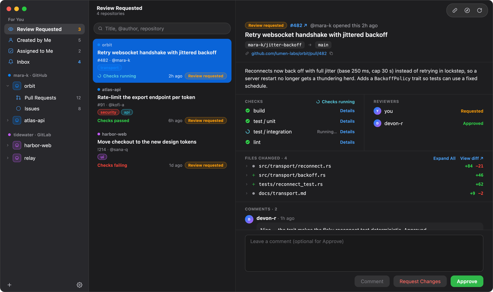
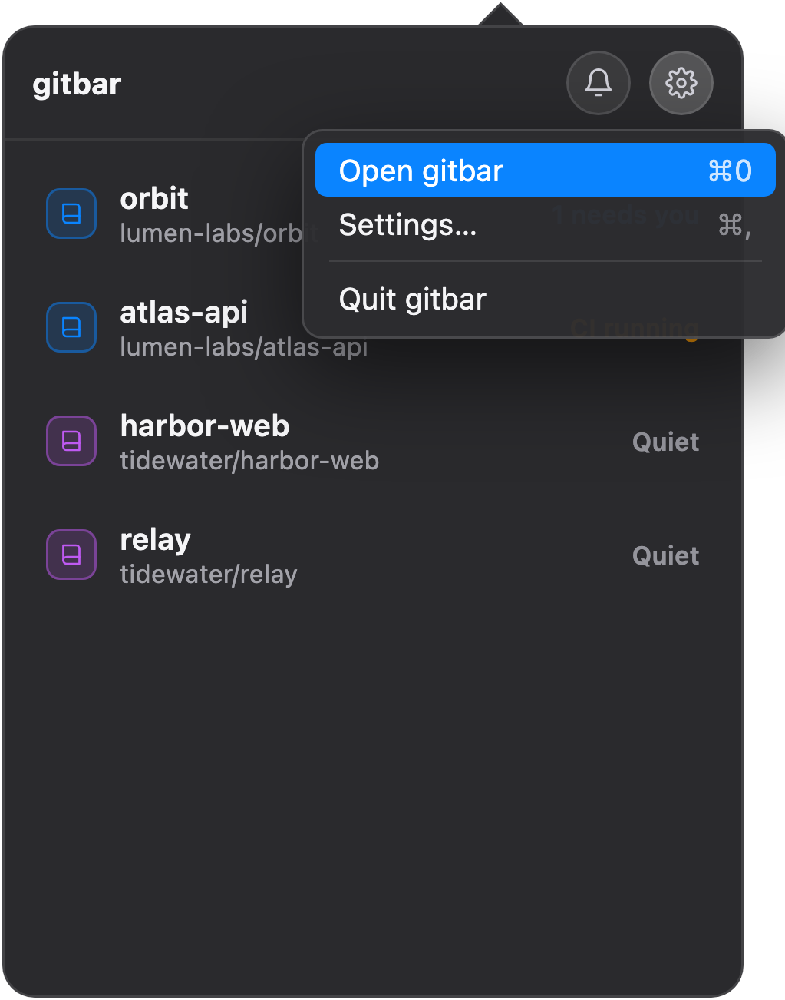
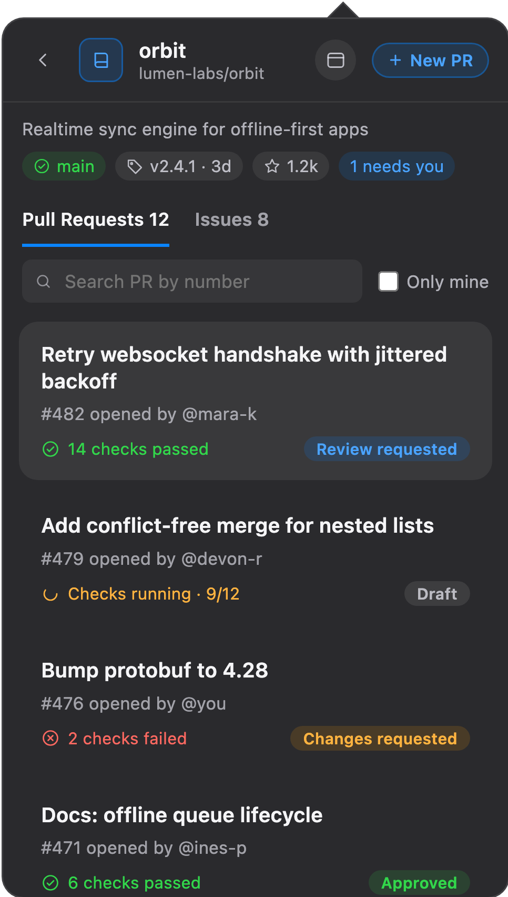
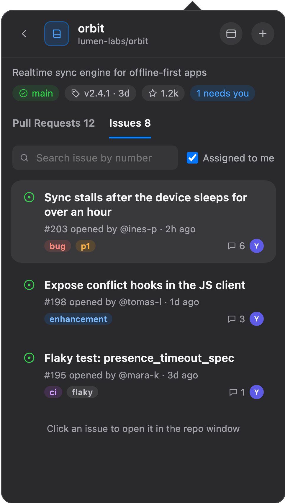
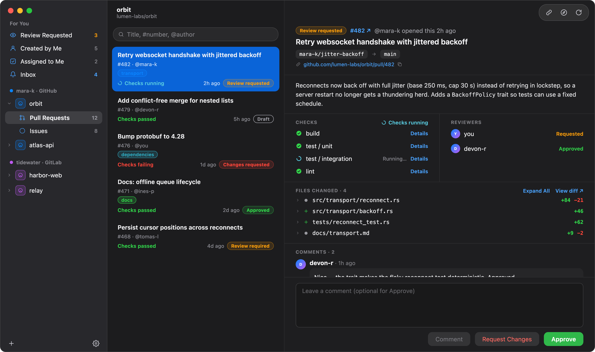
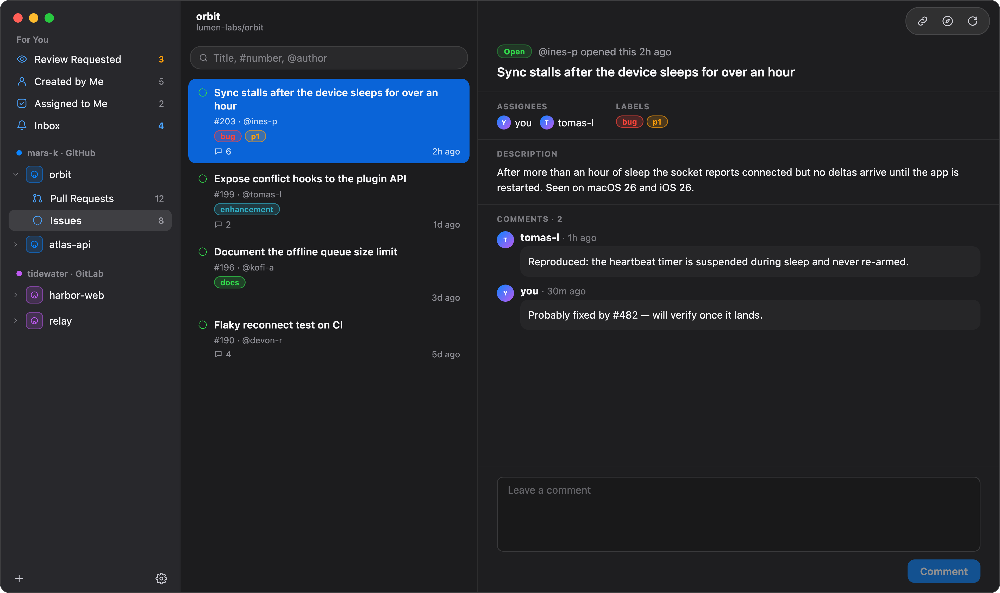
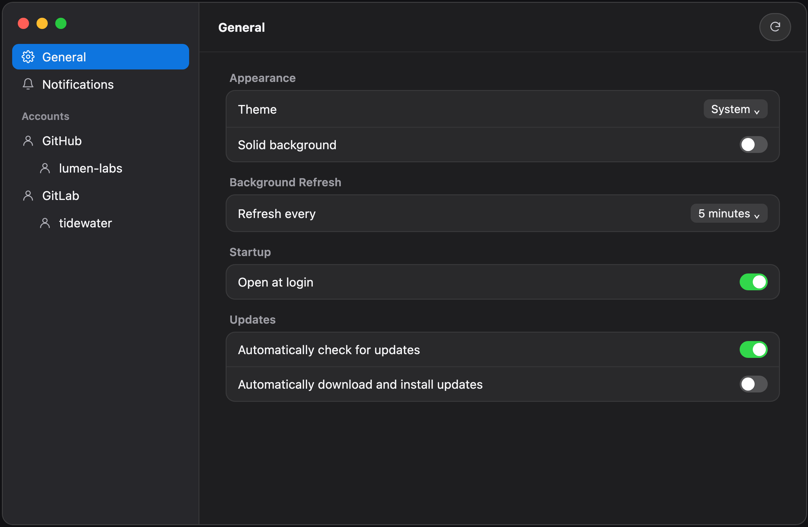

# gitbar

A native macOS menu bar app for your git repos. Pin the repos you care about, see at a glance which ones need you, and drill into pull requests — review, check CI, open new PRs — without leaving the menu bar.

GitHub (github.com and GitHub Enterprise Server) and GitLab (GitLab.com and GitLab Self-Managed) are supported today; the app is built so Bitbucket is one more module.

**Website:** [navaneethvijay.github.io/gitbar](https://navaneethvijay.github.io/gitbar/)

<p align="center">
  
</p>
<p align="center">
  
  
  
</p>
<p align="center">
  
  
</p>
<p align="center">
  
</p>

## Features

- **Pinned repos** with their status at a glance: all clear, CI running, or review requested. Each repo shows its provider's logo in its account's color — pick a color per account in Settings.
- **Pull requests and issues** per repo, paginated, with real CI status per PR — and an **Only mine** filter.
- **Accurate PR status**: Merged, Closed, Draft, Review requested, Changes requested, Approved or Review required — not just "Open".
- **Live CI**: running checks show a spinner and update on their own until they finish.
- **PR detail**: description (rendered Markdown), reviewers, checks, files changed, comments, a link to the PR — and submit a review (Approve / Request changes / Comment; GitLab has Approve / Comment).
- **Main window**: a three-column window like Mail: *For You* (Review Requested, Created by Me, Assigned to Me, Inbox) across every repo, your repos by account, and the full PR or issue, with **inline file diffs** (large and generated files stay collapsed until you ask). Open it from the popover or with ⌘0.
- **Issues**: labels, assignees and comments, an "Assigned to me" filter, and replies from the issue screen.
- **Create pull requests / merge requests**: pick source and target branch, title, and description — prefilled from the repo's PR or MR template.
- **Notifications**: an inbox of review requests, mentions, assignments and more, an unread dot on the menu bar icon, per-repo unread counts, and macOS alerts for new ones (you choose which reasons). GitHub needs a classic token with the `notifications` or `repo` scope; on GitLab this is your To-Do List (`read_api` or `api` scope).
- **Token check**: when you add an account, gitbar tells you what the token can do (read repos, review/open PRs, notifications) and how to fix what's missing.
- **Multiple accounts** across GitHub and GitLab, cloud or self-hosted.
- **Background refresh** (configurable), cheap on your rate limit: unchanged data comes back as `304 Not Modified`.
- Light / Dark / System appearance, an optional solid (non-translucent) background, and open at login.

## Install

gitbar is installed by **building it from source on your own Mac** — there's no `.dmg` or prebuilt download, by design. A copy you build yourself is never blocked by macOS: no security prompt, no "Open Anyway", and you can read every line of what you're running.

It takes about 5 minutes plus the Xcode download.

### 1. Install the tools (once per Mac)

You need **macOS 15 (Sequoia) or later**.

1. **Xcode** — install it from the [App Store](https://apps.apple.com/app/xcode/id497799835), then **open it once** and let it finish installing its components. The full Xcode app is required; the smaller *Command Line Tools* alone can't build a Mac app.
2. Point the command line at it and accept its license (asks for your Mac password):
   ```sh
   sudo xcode-select -s /Applications/Xcode.app/Contents/Developer
   sudo xcodebuild -license accept
   ```
3. **Homebrew** — skip if `brew --version` already works; otherwise follow [brew.sh](https://brew.sh).
4. **XcodeGen** (generates the Xcode project):
   ```sh
   brew install xcodegen
   ```

### 2. Build and install gitbar

```sh
git clone https://github.com/NavaneethVijay/gitbar.git
cd gitbar
make install
```

`make install` builds a Release copy, installs it to `/Applications/gitbar.app` and opens it. The first build also downloads two Swift packages (Sparkle and swift-markdown), so it needs internet and takes a few minutes; later builds are faster. When it's done, gitbar's icon appears in the **menu bar** (top right of the screen).

### 3. Connect your GitHub or GitLab account

1. Click gitbar's menu bar icon → gear icon → **Settings…** (⌘,)
2. **Accounts → GitHub → Add Account**, choose **Cloud** (github.com) or **Self-hosted** (GitHub Enterprise Server — enter your server's address).
3. Create a [personal access token](https://github.com/settings/tokens) and paste it in. A **classic** token with the `repo` scope covers everything, including notifications. gitbar shows what your token can and can't do right after you add it.

   **GitLab:** same steps under **Accounts → GitLab → Add Account** — **Cloud** (gitlab.com) or **Self-hosted** (your GitLab Self-Managed server's address). Create a [personal access token](https://gitlab.com/-/user_settings/personal_access_tokens) with the `api` scope (or `read_api` for read-only: browsing, no comments/approvals). Your GitLab To-Do List shows up as gitbar's notifications.
4. Pick the repos to show — they appear in the menu bar popover.

gitbar normally lives only in the menu bar. While its Settings window or main window is open it also shows in the Dock and ⌘-Tab, so you can bring those windows back from behind other apps.

### Update, remove, and other options

| | |
|---|---|
| Update to the latest version | `cd gitbar && git pull && make install` |
| Remove | `make uninstall` |
| Install without admin rights (to `~/Applications`) | `make install INSTALL_DIR=~/Applications` |

Updating keeps your accounts, tokens (stored in the Keychain) and pinned repos.

### Troubleshooting

| Problem | Fix |
|---|---|
| `error: XcodeGen isn't installed` / `xcodegen: command not found` | `brew install xcodegen` |
| `error: the full Xcode app is needed` / `xcodebuild requires Xcode` | Install Xcode, open it once, then run the two `sudo` commands from step 1. |
| `You have not agreed to the Xcode license` | `sudo xcodebuild -license accept` |
| `can't write to /Applications` | `make install INSTALL_DIR=~/Applications` |
| Build fails while resolving packages | Check your internet connection and run `make install` again. |
| Installed, but no icon in the menu bar | The menu bar may be full — quit an app or two, or check System Settings → Menu Bar for hidden items. |

## Development

```sh
make run      # Debug build (unsigned) and launch
make build    # build only
make clean    # remove build output and the generated project
```

## Roadmap

- **More providers.** Bitbucket, as a self-contained module on the existing provider architecture.
- **Repo overview** in the main window.

## Author

[NavaneethVijay](https://github.com/NavaneethVijay)

## License

MIT — see [LICENSE](LICENSE). Third-party notices in [NOTICE.md](NOTICE.md).
